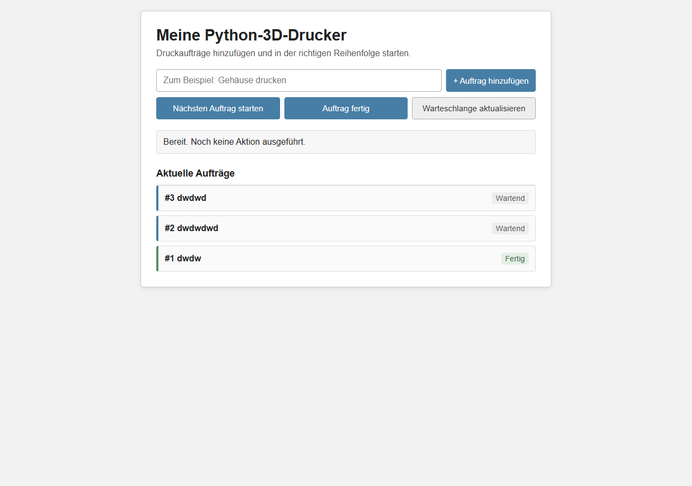

# 3D-Drucker-Auftragsverwaltung

## Kurzbeschreibung

Mit dem Programm kann man Druckaufträge für einen 3D-Drucker verwalten. Neue Aufträge werden in eine Warteschlange aufgenommen. Der erste Auftrag, der aufgenommen wurde, wird auch zuerst gedruckt. Das nennt man FIFO: First In, First Out.

Es kann immer nur ein Auftrag gleichzeitig gedruckt werden. Die Aufträge werden in der Datei `auftraege.json` gespeichert.

## Starten

1. Öffne in VS Code ein Terminal in diesem Ordner.
2. Starte das Programm:

```powershell
python main.py
```

3. Öffne danach diese Adresse im Browser:

```text
http://127.0.0.1:8000
```

4. Zum Beenden drückst du im Terminal `Strg+C`.

## Seiten und Routen

### Einfache Hauptseite

```text
http://127.0.0.1:8000/
```

Hier kann man Aufträge hinzufügen, starten, fertig machen und die Warteschlange sehen.

### Effekt-Version

```text
http://127.0.0.1:8000/?version=2
```

Diese Seite hat die gleichen Funktionen. Sie hat zusätzlich viele Animationen und Effekte.

### API-Route

```text
http://127.0.0.1:8000/api/action
```

Diese Route wird von JavaScript im Hintergrund benutzt. Sie verarbeitet die Aktionen der Buttons.

## Screenshot der Hauptseite

Hier soll ein Screenshot von der einfachen Hauptseite eingefügt werden:



Dafür das Programm starten, die Hauptseite im Browser öffnen und ein Bildschirmfoto als `main-page.png` in diesen Ordner speichern.

## Dateien

- `main.py`: Python-Server und Warteschlange
- `frontend.html`: einfache Oberfläche
- `frontend2.html`: Effekt-Version
- `auftraege.json`: gespeicherte Aufträge

## Status der Aufträge

- `Wartend`: Der Auftrag wartet in der Queue.
- `Wird gedruckt`: Der Drucker bearbeitet den Auftrag gerade.
- `Fertig`: Der Auftrag ist abgeschlossen.

Wenn drei fertige Aufträge gesammelt wurden, werden sie aus der Liste gelöscht. Wartende Aufträge bleiben erhalten.

## Wie die Queue funktioniert

Neue Aufträge kommen hinten in die Liste. Beim Starten wird immer der erste wartende Auftrag genommen. Dadurch gilt das FIFO-Prinzip. Es kann nur ein Auftrag gleichzeitig gedruckt werden.

Der Ladebalken zeigt die Druckzeit. Wenn er 100 Prozent erreicht, wird der Auftrag automatisch auf `Fertig` gesetzt.

## Eigene Buttons

Die Buttons stehen in `frontend.html` oder `frontend2.html`. Ein neuer Button braucht ein `data-action`. Danach muss in `main.py` ein passender `elif action == ...`-Block ergänzt werden.
